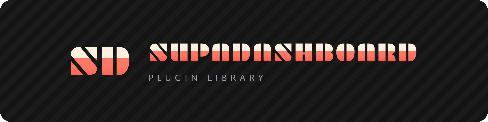
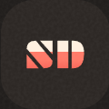
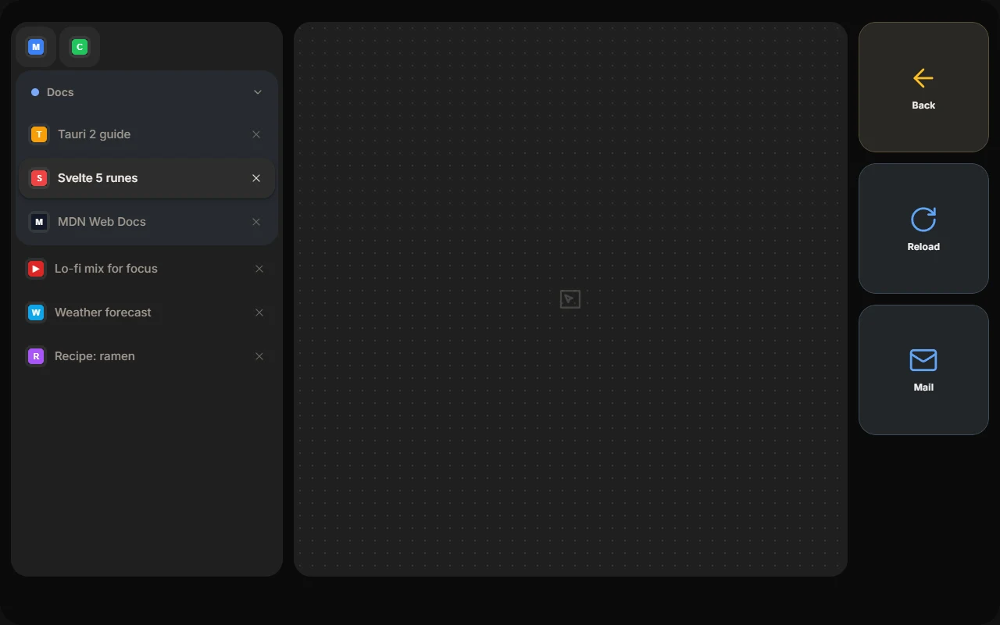
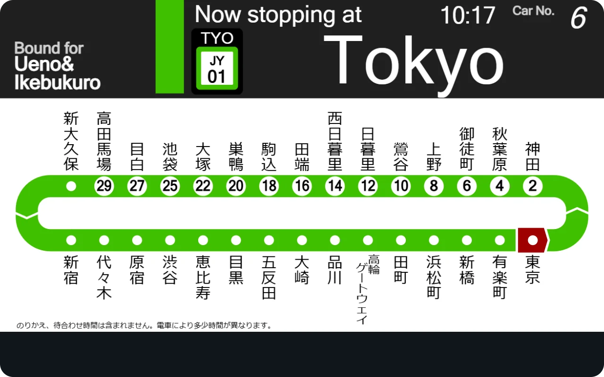

<p align="center">
  
</p>

<p align="center">
  Plugins for <a href="https://github.com/McFck/SupaDashboard">SupaDashboard</a>, built and signed by CI and
  published to the in-app Market.
</p>

<p align="center">
  <a href="LICENSE"></a>
  
</p>

## Plugins

Install them from **Market** in the SupaDashboard control panel. Each plugin page there has a **How to use** guide.

|                                                                    | Plugin                                             | What it does                                                                                                                |
| :----------------------------------------------------------------: | -------------------------------------------------- | --------------------------------------------------------------------------------------------------------------------------- |
|       | [Spotify](plugins/spotify)                         | Synced lyrics from LRCLIB, Spotify as a media widget source, like, shuffle and repeat buttons.                              |
|  | [SupaDashboard WebCompanion](plugins/webcompanion) | Switch, close and reorder browser tabs, a touchpad for the pointer and scrolling, websites and media in a Chromium browser. |
|       | [Discord](plugins/discord)                         | Voice channel widget, and mute, deafen, leave and rejoin through the Discord desktop app.                                   |
|       | [Android compatibility](plugins/haptics)           | Vibration on presses, screen lock with the PC and Artemis launch for an Android tablet over ADB.                            |
|        | [Subway](plugins/subway)                           | Japanese train information displays as a page applet, with chimes and station announcements.                                |

Spotify and Discord need a free developer app of your own; their guides walk through it.

<table>
  <tr>
    <td width="50%"></td>
    <td width="50%"></td>
  </tr>
  <tr>
    <td align="center">WebCompanion tabs and touchpad</td>
    <td align="center">Subway</td>
  </tr>
</table>

## WebCompanion browser extension

WebCompanion has two parts: the plugin and a Manifest V3 extension for Chrome, Edge and other Chromium browsers
(116 or newer). The extension connects only to SupaDashboard on the same PC, over `ws://127.0.0.1`.

**Chrome Web Store:** coming soon.

**Load unpacked:**

1. Download the [`plugins/webcompanion/extension`](plugins/webcompanion/extension) folder.
2. Open `chrome://extensions`, turn on **Developer mode**, click **Load unpacked** and pick the folder.
3. Pin **SupaDashboard WebCompanion** from the puzzle icon in the toolbar.
4. In SupaDashboard, open the WebCompanion plugin page and click **Generate code**. Type the six digits into the
   extension popup. Pairing is kept after restarts.

## Develop

Each plugin folder holds `plugin.json` (manifest: id, version, plugin API and permissions), `market.json` (Market
listing), `guide.md` (the in-app guide) and `ui/src` (Svelte 5 code written against `@supadashboard/kit`). The
`supadashboard` submodule provides the kit.

```sh
git clone --recurse-submodules https://github.com/McFck/supadashboard-plugins.git
cd supadashboard-plugins
pnpm install
pnpm check
pnpm test
pnpm build        # stages every plugin in dist/<id>
```

To try your changes, run `pnpm tauri:dev:plugins` in a sibling SupaDashboard checkout (`app/`). It builds and loads
the plugins from this folder and reloads the app after each UI rebuild.

### Releases and signing

- A push to `main` that changes `plugins/**` runs check, test and build, then `scripts/release.mjs --publish`.
- Every plugin whose version has no `<id>-v<version>` tag yet is packed into an `.sdplugin` archive with a
  `release.json` and its signature, and published as a GitHub release.
- CI then rebuilds the signed Market catalogue (release `catalogue-v2`) from the latest release of every plugin.
- The app checks both against the public key pinned in SupaDashboard (`keys/plugin-signing-pub.pem`). The private
  key exists only as a CI secret.
- Release builds of the app load only signed plugins. A development build (`pnpm tauri dev`) also installs an
  unsigned `.sdplugin` you packed yourself, marked unverified, after listing its permissions.

To publish a change, bump `version` in the plugin's `plugin.json`.

## License

GPL-3.0-or-later, see [LICENSE](LICENSE). SupaDashboard itself is at
[McFck/SupaDashboard](https://github.com/McFck/SupaDashboard).
